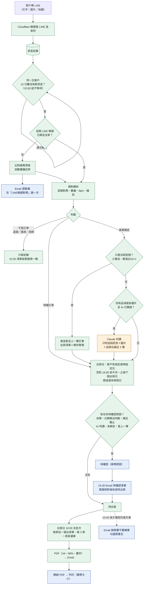

# 華暉 LINE 訂單流程

線上版（含說明）：https://claude.ai/artifact/M7uYdf8wSxcEjbXpaaf5RP

## 什麼時候才用 AI（由便宜到貴，前一步解決就停）
1. **規則解析**（免費）：型號對照、數量、8pin、不需工具。
2. **查上一筆訂單**（免費）：只說「小電池」「幫我出10+1」時，帶出這家店上一筆型號（出貨清單＋主檔庫存管理出庫）。
3. **特殊要求照規則自動處理**（免費）：
   - 指定日期（下週一、11/26、明天）→ 直接當出貨日；無法判斷（月底、過幾天）或不是出貨日 → 待確認
   - 中午後送／午後收貨 → 不處理，由廠商清冊店名「(午後收貨)」表示
   - 統編、發票 → 這張單價格組合改 D(稅外加)
   - 記下個月帳 → 寫進附註
   - 改單 → 依最新訊息更新、舊單改「取消」，標「改單須確認」；追加保留原單；取消要求 → 原單改待確認
   - 接近 16:00 截止、要求延後 → 待確認
4. **Claude 判讀**（付費，可關）：只在「沒有品項」或「有圖片」時；只送該段訊息、圖片、型號清單、這家店最近 3 筆訂單；結果一律待確認。
5. **把新說法加進「型號對照」**：下次在第 1 步就解決。

## 新店家／新客戶
- 已在廠商清冊：系統用 LINE 名稱與訊息比對，建議店家 → 客服在「LINE帳號對照」選一次 → 之前的訂單自動補店家。
- 全新客戶：先在主檔「廠商清冊」建檔（店名、地址、電話、收款條件、價格組合、發票樣式）→ 產單前自動同步 → 再選店家。價格組合沒填不會產單。

## 資料位置
| 資料 | 位置 | 誰維護 | 用途 |
|---|---|---|---|
| 廠商清冊 | 主檔 | 客服 | 產單、建議店家 |
| 訊息紀錄 | 華暉出貨自動化 | 系統 | 查證、15:30 清單 |
| LINE帳號對照 | 華暉出貨自動化 | 客服選一次 | 辨識店家 |
| 型號對照 | 華暉出貨自動化 | 客服增修 | 規則解析 |
| 出貨清單 | 華暉出貨自動化 | 系統＋客服 | 產單、查上一筆 |
| 庫存管理（出庫） | 主檔 | 客服 | 舊客戶歷史、查上一筆 |
| 批次紀錄 | 華暉出貨自動化 | 系統 | 補印、追查 |
| 列印檔 | 雲端硬碟／每月資料夾 | 系統 | PDF 列印 |

## 多店帳號與群組
- 一個 LINE 帳號或群組管多家店：在「LINE帳號對照」同一個 ID 加多列，每列選一家店。
- 系統依訊息中的**送貨地址**（路段＋門牌）或**分店名稱**判斷是哪一家；都沒寫就標待確認。
- 群組：官方帳號要在群組裡（官方帳號後台 → 設定 → 帳號設定 → 允許加入群組）。公司同事的 LINE 名稱填在「設定 → 本公司人員」，他們在群組講的話不會當成訂單。

## 新客戶建檔（人工確認）
1. 找不到店名或地址相符的新 LINE 對話 → 自動建立「新客戶待建檔」草稿（店名、地址、電話、統編、區域、預設價格組合）。
2. 預設價格組合：要工具 B；不用工具但要統編發票 D(稅外加)；其他 A。
3. 客服補齊必填（店名、送貨地址、電話、價格組合、收款條件）後勾「確認建檔」。
4. 系統把這家店**接在主檔廠商清冊最後一列之後**新增（不修改既有資料），同步並綁定 LINE，補上之前訂單的店家。訂單仍需客服勾「確認」才會產單。
5. 其實是舊客戶：直接在「LINE帳號對照」選店家，草稿會自動標成不需建檔。

## 庫存管理
產單後自動把出庫（每行一列）與 10+1 特贈（另一列）接在主檔「庫存管理」最後面，建檔人員為「系統」，備註寫單據編號與批次；不會修改既有資料。
